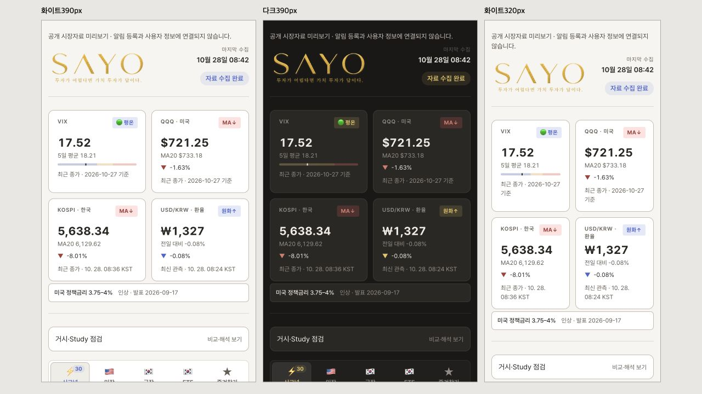
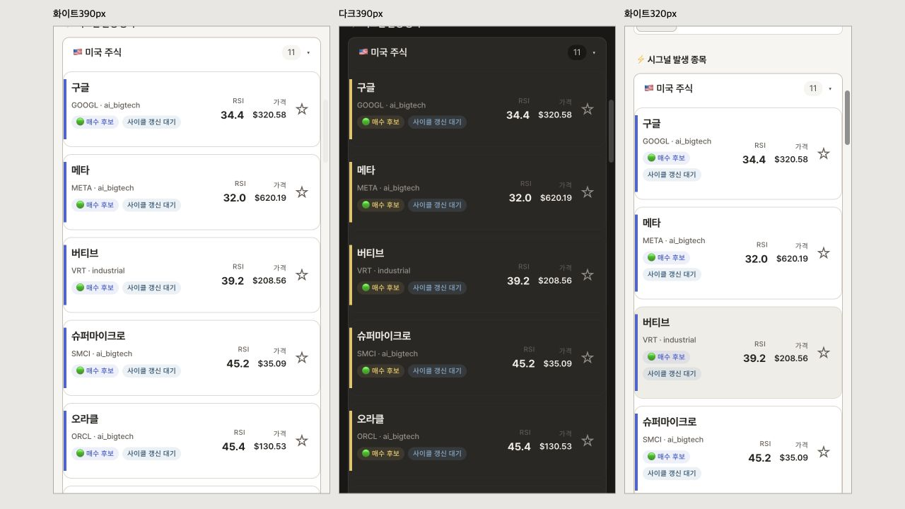
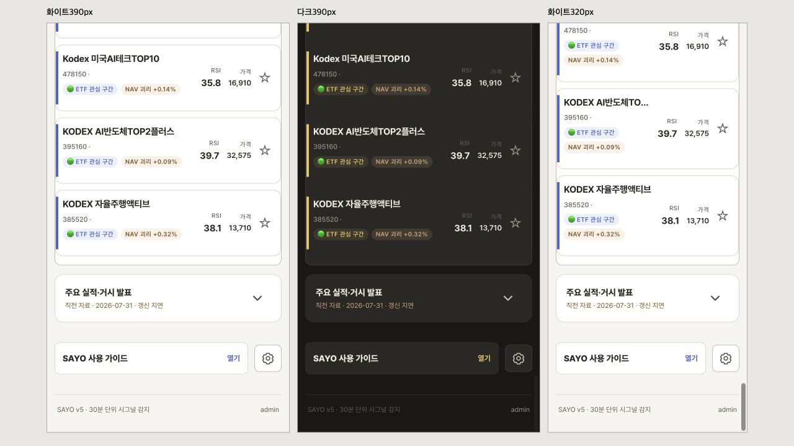

# 모바일 UI 및 정책 동기화 복구

2026-10-28 KST. 사용자 제공 모바일 화면 3장에 대한 수정과 정보 동기화 검증. 토큰·서비스계정·FCM/관리자 문서·브라우저 저장소·로그인 세션은 조회하지 않았다. 기존 미커밋 config.py와 화면 지도 SVG는 변경에서 제외한다.

## 확인된 원인과 변경

| 대상 | 확인한 사실 | 수정 |
| --- | --- | --- |
| 종목 좌측 색 | 여러 CSS 규칙의 4/5px border-left와 곡선 외곽선이 함께 적용됨 | 카드의 1px 외곽선을 유지하고 내부에 4px 직선 띠. 위·아래 각10px 안쪽, 직각 끝. 마지막 카드의 하단 외곽선도 유지 |
| 주요 발표 화살표 | 작은 문자와 기준선 정렬 | 24px SVG chevron,44×44px 영역, 세로 중앙, 펼침 시 회전 |
| 거시 4개 | 데스크톱 최대42px·모바일20px 간격 | 기존2×2 유지, 데스크톱14px·모바일10px.320px에서 제목·배지 겹침도 별도 공간 확보로 해결 |
| 설정 | 헤더 텍스트 버튼 | 사용 가이드와 같은 하단 행의 독립44px 톱니바퀴. ID·키보드·팝업 연결 유지. 모바일 중복 floating guide를 숨겨 카드 가림을 줄임 |
| 로고 | 이미지가 컨테이너 중앙에 맞춰짐 | 헤더 start 정렬, 이미지 left top, 데스크톱72px·모바일64px 높이 |
| 정책 자료 | 만료된9월 전망 신호 및 이벤트 전체 발행 게이트에 의존 | 공식 Fed calendar→최신 과거 정책 성명을 독립 검증하는 공통 helper 추가. Study와 시장 수집기가 같은 helper를 사용하며 시장 수집이 직접 복구 가능 |
| 정책 파서 | 공식 성명의 `raise/lower ... by ... to`를 놓치고 `at`만 인식 | 인상·인하·유지와 분수/소수 목표범위 인식. 날짜·실제 release 시각·공식 도메인·범위 검증 |
| 다음 정책 회의 | 같은 달력에 있는 회의록 발행일을 회의일로 오인 | Released 날짜를 회의 후보에서 제외. 실제 페이지에서9/16 결정의10/7 회의록과10/28 회의를 구분 |
| 이벤트 표시 | 만료된7/31 자료를 ‘공식 일정 갱신’으로만 표시 | 유효기간·소비 상태를 함께 확인해 직전 자료/갱신 지연을 표시. 만료 피드에서 다음 실적 일정을 만들지 않음 |
| ETF 가격 | NaN 종가가 None 검사와 스냅샷 보완을 통과하지 못한 뒤 저장 시 null로 변환됨. 공개15종목 모두 가격null이지만 행 개수 때문에success | 유한 양수 가격만 허용하고 네이버/스냅샷 fallback 작동. fallback 원천과 그 기준일을 함께 보존. 최종 가격 미확보는 critical quality 오류로partial 집계 |

정책은 관측된 공식 결정만 제공한다. 미래 금리 확률·매수 조건·임계값·알림 정책을 변경하지 않았다. 원래 다크 금빛/화이트 파란색을 유지한다.

## 정책 갱신·실패 처리

- 인증 없는 공개 자료 최대2회, 각12초 timeout, 2MB 상한. HTTPS와 최종 리다이렉트 도메인은 연준으로 제한한다.
- 성공 자료는6시간 재조회 간격, 결정일에는1시간. 실패는1시간 뒤 재시도한다. 별도 스케줄을 만들지 않고 기존 시장 수집 회차에서 재조회 조건을 검사한다.
- 실제 발표 시각과 수집/확인/마지막 성공/다음 확인 시각을 분리한다. 다음 회의 뒤까지 이전 결정의 유효기간을 임의로 연장하지 않는다.
- 재조회 실패 시 유효한 직전 결정은 last_verified·재확인 지연으로 표시한다. 만료·미검증은 unavailable이며 정상·중립으로 바꾸지 않는다.
- Study 이벤트 전체 검증 게이트는 낮추지 않았다. 정책 복구와 이벤트 피드 완전성은 별개다.
- 실제 인터넷 응답을 이용한 검증에서 공식 목표범위3.75–4%, 발표2026-09-17 03:00 KST, 다음 결정일2026-10-28(미국 현지일)을 확인했다. 참고: [Fed 공식 성명](https://www.federalreserve.gov/newsevents/pressreleases/monetary20260916a.htm), [공식 달력](https://www.federalreserve.gov/monetarypolicy/fomccalendars.htm). 시장 의견이나 추천이 아니다.

## 실행·신선도 관측

- 토큰 교체 후 첫 외부 경로 접수: wrapper run40531702326,00:30:44 KST,실제job시작00:30:48.
- 08:31경 공개 조회에서 최근12회 wrapper가 workflow_dispatch로 약30분 간격(01:00:57~06:30:41 KST)에 접수되고 모두 success였다. 이 범위의 연속 접수는 확인된다. 공개 메타로 KR/US 작업명을 구분할 수 없으며 외부 실제 DST·거래소 휴장/조기폐장 설정 전체를 검증한 것은 아니다.
- 수정 전 최신 공개 수집은06:37:07 KST. 프로세스success와ETF가격완전성은 달랐다. 이 차이를 이번 품질 검사에서 보완한다.
- Study cycle 발행 ID와 SAYO 소비 ID는 일치하지만 종목별 만료·근거 부족 상태는 남아 있다. 이벤트는8/8 만료본 fallback이며 이번 정책 복구를 이벤트 전체 정상화로 해석하지 않는다.

## 검증

- 생산 코드 AST/합성 공급자 회귀: 정상·NaN/Inf/0/음수·빈 history·네이버 가격·스냅샷 보완·보완 실패·분배 계산기 유지·최종partial 및 가격 원천일 보존.
- 정책 회귀: 정상·timeout·공급자 오류·빈 문서·미래/외부 링크·발표 시각/날짜 불일치·캐시 성공/실패 수명·회의록 날짜 제외·Study만료→공식fallback→공개캐시.
- FE: 정책 만료/확인 지연/잘못된 URL, 이벤트 만료/동기화 실패, 테마·푸시저장실패·초점·키보드·값/그래프, 전체공개미리보기74표시행(원본44종목의탭중복포함).
- Study 단위 101개, root 관련 단위 검사 148개, HTML/JSON정적검증·JSONSchema·정책publication health·CSS파싱·JS문법·gitdiff공백검사.
- CUA로 공개 시장자료를 넣은 무인증 로컬 재현 화면을390px의 두 테마 및320px에서 상단→종목→ETF→하단까지 스크롤해 점검했다. 320px html/body scrollWidth=clientWidth=320, 환율 제목/배지 비겹침, 실제 카드stripe폭4px·좌우1px외곽선·상하10px 안쪽을 계측했다. 하단 설정 톱니바퀴로 팝업 열림도 확인했다.
- 실제 계정 승인·실제 FCM 발송은 테스트하지 않았다. 이 작업의 수동 검증 수집은 기존 보안 CI 경로와 푸시 생략 정책을 이용한다.

## 배포 후 화면 재검증

- 공개 서버의 HTML·CSS·JS 및 Study 정책 JSON을 다시 받아 SHA-256을 대조했다. 네 파일 모두 로컬 배포본과 일치한다. SAYO 자산 버전은 `20261028-layout-sync-1`이다.
- CUA에서 390px 화이트/다크, 320px 화이트를 상단부터 전체 시그널 목록·ETF·하단까지 스크롤했다. 320px 거시 카드 네 개는 각각 143×167.98px, 가로 넘침 없음, 간격 10px이다.
- 카드 내부 띠는 폭 4px, 상하 10px 안쪽, 곡률 0px이다. 카드 왼쪽 외곽선은 1px로 유지된다.
- 발표 화살표는 24×24px SVG, 표시 영역은 44×44px이며 부모 중심 대비 세로 오차는 0px이다. 펼침 시 180도 회전한다.
- 설정 버튼은 한 개이고 가이드와 나란히 놓인다. 팝업을 닫으면 초점이 설정 버튼으로 돌아온다.
- 320px에서 VIX 값·그래프 전환과 팝업 내부 하단 스크롤을 확인했다. 팝업의 clientWidth와 scrollWidth가 모두 284px이며 출처와 관측 기간까지 표시된다.
- 공개 자료를 주입한 재현 화면이며 실제 계정 로그인·FCM 등록은 수행하지 않았다.

## 운영 수집 최종 대조

관측: 2026-10-28 08:44 KST. [실행 40603270750](https://github.com/insightnexusofficial-maker/stock-signal-agent/actions/runs/40603270750), 코드 `af5b99d2b343c768d500d33be2d16c4c8bd989d3`. 요청 접수 08:36:22, job 시작 08:36:24, 시장 자료 수집 종료 08:42:51, job 종료 08:42:59 KST. 실행 결론은 success이다. 이는 이번 한 번의 푸시 생략 QA 실행이며 정규 cron 접수 증거와 구분한다.

| 범위 | 직접 확인한 사실 | 판정과 한계 |
| --- | --- | --- |
| 핵심 수집 | 미국 22·한국 7·ETF 15·핵심 거시 4로 기대 개수와 일치. critical 오류 0 | 핵심 시장 수집 성공. Study 이벤트 오류 1은 별도 |
| 저장 시각 | stocks/data와 stocks/last_good의 collection_finished_at이 모두 08:42:51 | 현재 자료와 마지막 성공 자료 일치 |
| ETF 가격 | 15/15 유한 양수, price_source=yahoo_history, price_as_of=20261027 | 장 시작 전 전 거래일 가격. 오늘 실시간 가격으로 해석하지 않는다 |
| ETF 부가 항목 | 일부 52주 위치·분배율 항목은 stale_filled_fields로 표시됨 | 가격 복구가 모든 부가 지표의 신규 관측을 의미하지 않는다 |
| 정책금리 | quality=passed, verification=success, data=current, 범위 3.75–4%, 공식 발표 시각 9/17 03:00 KST, 확인 10/28 08:33:22 | 동기화 성공. 검증된 Study 정책 파일을 소비했다. 직접 재조회 fallback은 별도 회귀 검사로 검증 |
| 정책 재확인 | next_check_at=10/28 14:33:22, expires_at=10/29 13:00 KST. 미국 회의 당일에는 1시간 재확인 조건도 적용 | 기존 수집 회차가 실행될 때 확인한다. 항상 외부 응답 성공을 보장하는 의미가 아니다 |
| 확장 거시 | market_environment quality=complete, 8/8 계열 수신, unavailable 없음 | 관측일은 계열별 상이하다. 월간·주간 통계를 오늘 날짜로 바꾸지 않음 |
| Study 보고서 파일 | report_id=semiconductor-cycle-2026-10-24-1730-weekly, 만료 11/1 | 파일 유효. 종목별 근거 유효성과는 별개 |
| Study 종목 근거 | 미국 current 3·expired 17·unavailable 1·비대상 1, 한국 expired 5·비대상 2 | 종목별 Study가 모두 최신인 상태는 아님. insufficient/갱신 대기를 유지 |
| 발표 일정 | event_sync_status=unavailable, 직전 feed ID 유지, event_feed 오류 1 | 만료본 fallback. 최신 일정으로 표시하지 않음 |
| 커버드콜 분배 | 498400·0219E0·0177R0의 distribution_update_due=true | 3개 상품 분배 자료의 추가 현행화가 필요하며 이번 가격 복구와 구분 |

이번 판정은 **화면 수정 배포 완료, 핵심 시장 수집과 정책 동기화 복구**이다. Study 이벤트·종목별 근거·일부 분배 자료까지 전체 최신화됐다고 판정하지 않는다. 외부 cron의 관리 화면·인증값·정확한 DST 규칙은 열람하지 않았으며, 앞서 적은 공개 접수 12회의 관측 범위만 확인했다.

[수치 증거 JSON](UI_POLICY_SYNC_EVIDENCE_2026-10-28.json)

상단·정책 표시: 

카드 내부 띠: 

발표 화살표와 설정: 
